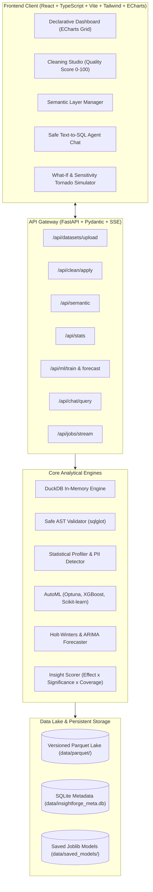
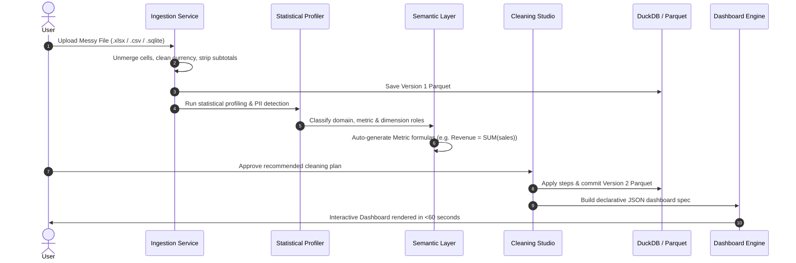

# InsightForge AI (v2) - Architecture Specification

## 1. Executive Summary & Tenets
**InsightForge AI** is an enterprise-grade autonomous data analyst platform designed to ingest raw, messy datasets or live relational databases and produce clean data, declarative dashboards, statistical tests, and machine learning forecasts in under 60 seconds.

### Fundamental Non-Negotiable Tenets:
1. **Code computes, AI explains**: The LLM is strictly prohibited from generating numbers. Every number on every chart, card, and insight originates from deterministic SQL (DuckDB), SciPy, or scikit-learn models, equipped with reproducible "Show how" links.
2. **Honest labels**: Transparent badges accompany every datum:
   - `[Computed]` (SQL/mathematical aggregation)
   - `[Statistical test]` (ANOVA, FDR-corrected p-values, Pearson/Spearman)
   - `[ML prediction]` (XGBoost, Holt-Winters, Optuna, Scikit-learn)
   - `[AI-generated]` (Qualitative explanations and recommendations)
3. **Non-destructive Parquet lake**: Raw uploads are never mutated. All operations generate immutable versioned Parquet files with full undo/redo and restore capabilities.
4. **Autopilot vs. Review modes**: Autopilot executes end-to-end cleaning and dashboarding instantly; Review mode presents step-by-step impact previews for human-in-the-loop authorization.

---

## 2. System Architecture Diagram

---

## 3. Data Processing Pipeline

---

## 4. Security Architecture

1. **sqlglot AST Query Validation**:
   - Only `SELECT` and `UNION` statements are permitted.
   - Access is restricted to virtual memory tables (`data`, `dataset`).
   - System/disk-access functions (`read_parquet`, `copy`, `install`) are completely banned.
   - Automatic query limit enforcement (max 10,000 rows) prevents denial-of-service.
2. **Read-Only Database Enforcement**:
   - Connection validation blocks `INSERT`, `UPDATE`, `DELETE`, `DROP`, `ALTER`, and `CREATE`.
3. **Privacy Mode & PII Masking**:
   - Automatic regex detection for emails, phones, SSNs, and credit cards.
   - Dynamic hashing masks PII before any data reaches external LLM adapters.
4. **Sandboxed Code Execution**:
   - Zero network connectivity inside analytical sandbox.
   - 10-second hard execution timeout and 512 MB memory boundary.
